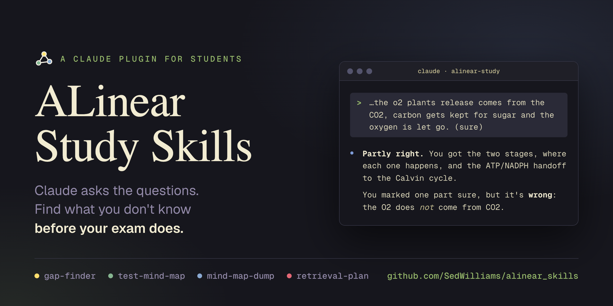
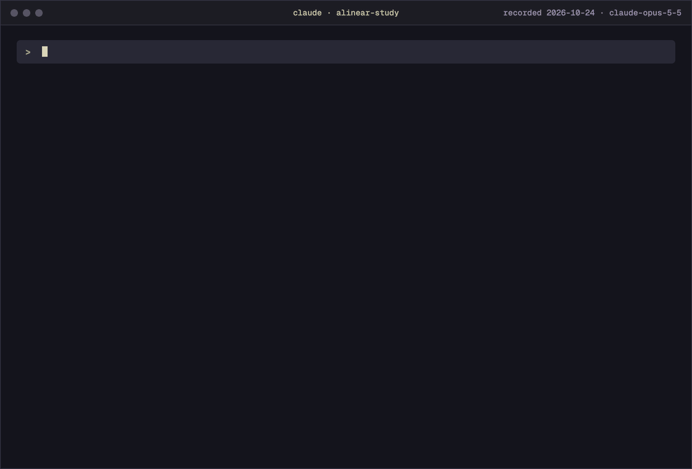

<div align="center">



# ALinear Study Skills

**Find what you don't know before your exam does. Claude asks the questions, and you do the thinking.**

[](LICENSE)
[](skills/test-mind-map-v1/scripts/map_checks.py)
[](#the-skills)

</div>

Asking an AI to explain a topic feels like studying. The AI does most of the work, though, and the gaps in your own understanding stay hidden until the exam finds them. These four skills turn that around. Claude asks one question at a time, you answer from memory, and a right answer you weren't sure of counts as a gap. Each session ends with a ranked list of what to fix and when to test yourself again.

The plugin is four Markdown skills. It also keeps the previous version of test-mind-map, which includes one Python script that uses only the standard library. Beyond the Claude app you already use, it needs no account or API key, and it sends nothing anywhere.



The demo is a real session, recorded in Claude Code. A second Claude call played the student. It answered from a fixed profile of what the student knows and gets wrong. The GIF skips the middle of the session.

## Quick start

You need Claude Code. For claude.ai and Cowork, see below.

```sh
claude plugin marketplace add SedWilliams/alinear_skills
claude plugin install alinear-study@alinear
```

Start a new session and ask for a quiz on something you've studied, such as `Quiz me on the Krebs cycle. My exam is Friday.` Claude picks the right skill from what you ask, or you can call one by name, such as `/alinear-study:gap-finder`.

### claude.ai and Cowork

Download this repository as a zip. In claude.ai or the desktop app, go to **Customize → Plugins → Add → Upload plugin** and choose the zip.

## The skills

| Skill | Ask something like | What happens |
|---|---|---|
| `gap-finder` | "Quiz me on the Krebs cycle. My exam is Friday." | One question at a time, big ideas first, with a confidence tag on every answer. Ends with a gap report and a date for the next session. |
| `test-mind-map` | "Here's my mind map of the French Revolution. Grill me on it." | Finds the defects in the map one question at a time, then works out which building habits caused them. Ends with a report of techniques to fix each one. It never redraws your map. |
| `mind-map-dump` | "I drew this from memory. Here are my lecture slides. What did I miss?" | Marks what you recalled against your material as right, wrong, missing, or unsure, with the big ideas weighted most. |
| `retrieval-plan` | "How should I revise organic chemistry this week? I have three hours." | Picks techniques that fit the material and how long ago you learned it, then turns each gap into a fix and a retest date. |

Each one works on its own. They share one set of gap types (Locked, Missing, Wrong, Shaky, Unlinked, Can't apply, Can't create, Blind spot), so reports from different sessions line up.

## How test-mind-map works

A mind map records how you encoded a topic, so its defects point back to how you built it. This skill finds the defects, asks what each one costs you, and works out which habit caused it. Then it tells you which technique to use instead.

It takes a photo or image, a JSON export, a Mermaid mindmap, an outline, or a description. ALinear workspace exports and the text of ALinear's Build AI prompt work too. It asks once for the material the map covers, because some holes only show against an outside source. It also asks about the map's stage, how you made it, and which parts come back slowly or feel arbitrary. A first draft should be sparse, so heavy detail that early counts against it.

Before the first question, Claude reads the whole map and checks it for more than twenty signs of a defect. Examples are a backbone that copies the source's headings, every link running out from the center, a node with more than four branches, plain unlabeled lines, and facts with no links. It ranks what it finds and spends most of the session on the backbone and the chunks, since a gap there makes many details hard to remember. You don't see the list, because some suspects turn out to be fine.

Then it asks one question per turn. You answer from memory with the map hidden, tagged "sure" or "unsure". Each suspected defect takes three turns. Claude tests it with a question that names the place on your map, reads your answer and logs any gap, then asks how that part was built. That last question separates a technique that can't work from a good technique done wrong. A map that felt smooth and quick to build usually came from transcribing. One that felt slow and uncertain usually came from real thinking, even if it still has defects. If your material has an idea your map lacks, Claude climbs a cue ladder from no cue, to a partial cue, to the name, so it never names the idea first. It ends the session only when you say "finish".

It won't make or reorganize your map. It doesn't suggest group names, groupings, or what a link should say, because then you'd be reading a structure instead of building one. If you ask for a fixed map, it says why and offers a technique and a question instead. When you see a problem but not the fix, it demonstrates the technique on a bread-baking map, then asks you to apply it to yours.

When you say "finish", you get a short report:

- Up to six defects, worst first. Each has what it costs you, such as slower recall or trouble with new problems, and its cause. A cause that never came out is marked as suspected.
- Techniques for those defects, picked from a set of 13 that includes prestudy, importance-based chunking, and re-chunking with the 2-4 rule. Each has steps that name the questions to ask, never the answers, and how doing it right feels. For a good technique done wrong, the report says what you did instead and gives the proper version.
- Your gaps, typed with the same eight types as gap-finder, and where to re-learn each one.
- What the map does well, including things you knew that the map didn't show.
- One technique to practice on the next map, and one challenge. Build a second structure for the same material around a different idea, then compare the two.

It then offers to save the report as markdown or add it to your notes, which it does only after you say yes. It also offers a gap-finder session if the gaps reach past the map into the topic, and a retest of the reworked map later.

The standards come from concept-mapping research and from iCanStudy's GRINDE, DAAPPR, and VPReFRE checklists. They all live in one file, `skills/test-mind-map/SKILL.md`, with the citations at the end.

The previous version is kept in `skills/test-mind-map-v1/`. Claude never picks it on its own. Call `/alinear-study:test-mind-map-v1` to run it. It's the one that runs `map_checks.py`, a Python script that counts branches, cross-links, and separate clusters before the questions start.

## Try it

Clone the repository and start Claude Code inside it, so the prompts below can find the example files:

```sh
git clone https://github.com/SedWilliams/alinear_skills.git
cd alinear_skills
claude
```

The `examples/` folder has material to try the skills on:

- `photosynthesis-notes.md`: one page of source notes.
- `photosynthesis-map.json`: a student's mid-study map of the same topic, with some holes in it.
- `alinear-workspace.json` and `alinear-prompt.txt`: ALinear's built-in photosynthesis example, as a workspace export and as the text of its Build AI prompt.

Three prompts, one per kind of session. The first one starts the session in the demo.

1. `Quiz me on photosynthesis using examples/photosynthesis-notes.md. I studied it yesterday.`
2. `Test my mind map in examples/photosynthesis-map.json against examples/photosynthesis-notes.md. It's a mid-study draft.`
3. `I have a biology midterm in two weeks on photosynthesis and cellular respiration. Plan my review sessions.`

## Why it won't just tell you the answer

Pulling something out of memory makes it stick better than reading it again (Roediger & Karpicke, 2006). Trying first, even when you get it wrong, helps the right answer stick once you see it (Kornell, Hays & Bjork, 2009). A session where Claude explains and you nod along skips both. So the skills hold back the answer until you've committed to one, and they count a right answer you weren't sure of as a gap, because unsure answers are the ones that tend not to come back (Butler, Karpicke & Roediger, 2008).

They also escalate. Three sure, correct answers in a row means the questions are too easy to show what you know, so the next one gets harder.

Each skill lists the studies its rules come from, in its `references/` folder or at the end of its `SKILL.md`.

## Works with ALinear

I also built [ALinear](https://alinear-gold.vercel.app), a study workspace for college students. You map a topic as a graph, say why each link exists, and write your own answer before it builds a prompt for your AI tool.

`test-mind-map` reads ALinear's output directly. Paste the text from ALinear's **Build AI prompt**, or give it a workspace `.json`, and it checks the structure from that instead of from a photo of your handwriting. You don't need ALinear for any of the skills.

## Privacy

The plugin has no server and makes no network requests. The skills are instructions Claude follows in your conversation. The one script, `map_checks.py`, belongs to the previous version of test-mind-map. It runs on your machine and reads only the file you pass it. What you share in the conversation follows the terms of the Claude app you use. If you ask Claude to read or write your notes in a connected app such as Notion, it uses that connector under that app's terms, and it writes only after you say yes. [PRIVACY.md](PRIVACY.md) has the details.

## Limits

- With no material from you, Claude checks your answers against its own knowledge, which can be wrong and may not match your course. Give it your notes or slides for anything graded.
- It won't do graded work. Give it a live assignment and it writes parallel questions on the same ideas instead.
- Photos of handwritten maps can be misread. The skills tell you how they read each unclear label and what they couldn't read, so you can correct them.
- A session takes effort and feels slower than asking for an explanation.

## Credits

The research behind each rule is cited in the skills' `references/` folders.

I learned much of how I study from iCanStudy, Dr Justin Sung's learning program ([icanstudy.com](https://icanstudy.com)). Treating every review session as a hunt for gaps is a habit I picked up there. Its frameworks, such as GRINDE maps and the Bear Hunter System, belong to iCanStudy, and this plugin doesn't teach or reproduce the course. If you want the full method, take the course.

## Development

```sh
claude plugin validate --strict .                                                      # manifests and skill front matter
python3 skills/test-mind-map-v1/scripts/map_checks.py examples/photosynthesis-map.json  # v1: structure report for the sample map
python3 skills/test-mind-map-v1/scripts/map_checks.py examples/alinear-workspace.json   # v1: same checks on an ALinear export
claude --plugin-dir .                                                                  # one session with the skills, no install
node marketing/tools/assets.mjs                                                        # rebuild the README images from the recorded session
```

The README images come from a real session. `node marketing/tools/record.mjs` runs gap-finder in Claude Code with only this plugin loaded. It works in a throwaway folder that holds the sample notes, and a second Claude call plays the student. It saves the transcript to `marketing/tools/session.json`. `node marketing/tools/assets.mjs` draws that transcript as `docs/assets/demo.gif` and `docs/assets/social-card.png` and makes no Claude calls. Recording uses a few dollars of Claude usage, so record again only when gap-finder changes. The assets script warns you when it has.

```text
.claude-plugin/     plugin.json and marketplace.json
skills/             one folder per skill: SKILL.md, references/, scripts/
examples/           sample notes, a sample map, and ALinear's example export
assets/icon.png     the listing icon
marketing/tools/    README image capture and the recorded session, not part of the plugin
docs/assets/        the images this README shows
```

## Contributing

Issues and pull requests are welcome. See [CONTRIBUTING.md](CONTRIBUTING.md) for setup and the checks to run before a pull request.

## License

[MIT](LICENSE) © Shedrick Williams
